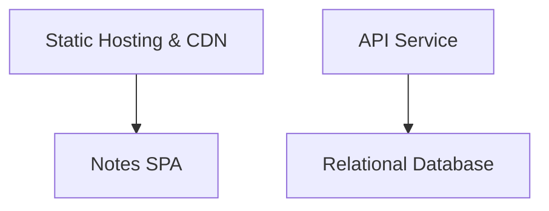
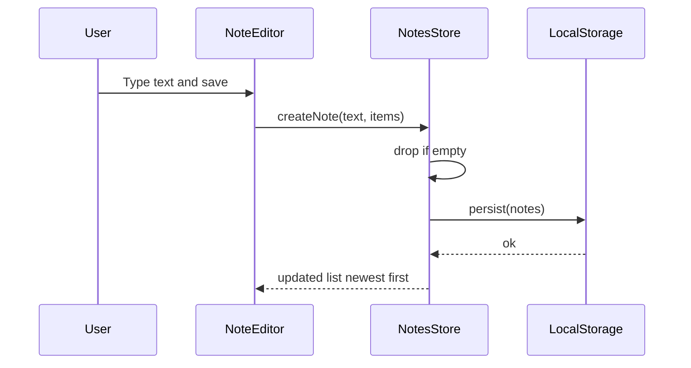
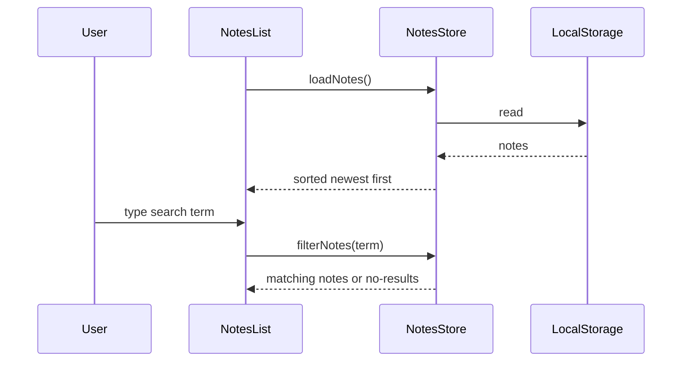
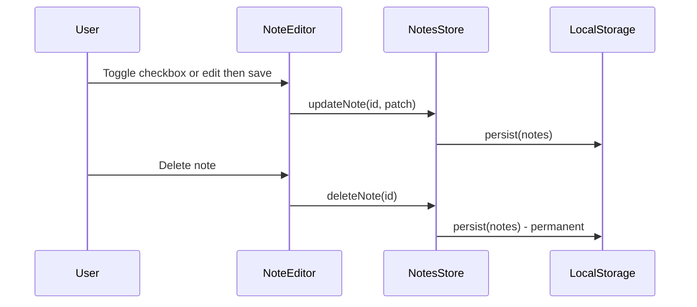
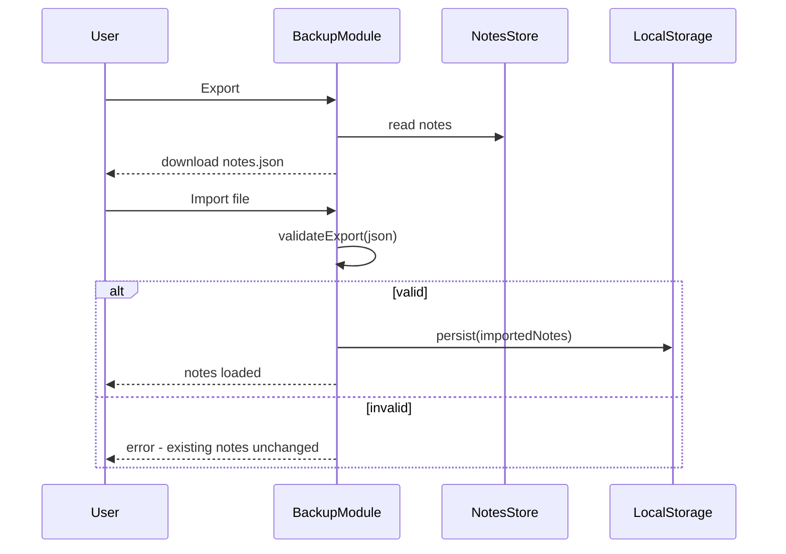
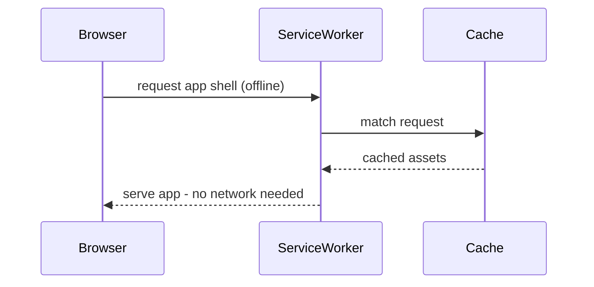
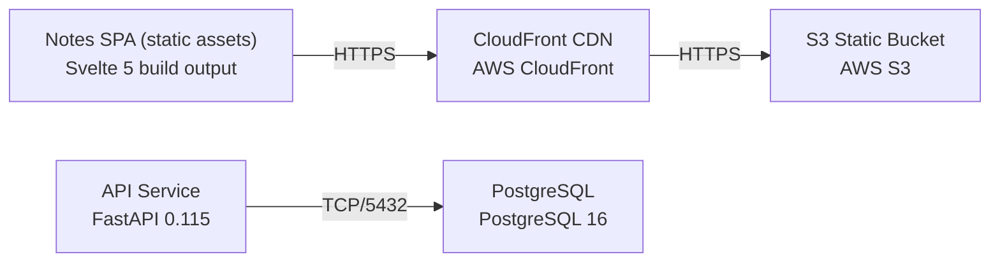

# Architecture

> Maintained by QuorQ AI SDLC. Text between `sdlc:auto` markers is regenerated; anything outside them is yours and is kept.

<!-- sdlc:auto:start narrative -->
## Overview

### ARCH-001 · approved · source: architecture:summary

Approved v1 architecture: a browser-only Notes SPA (Svelte 5) that creates, views, edits, deletes, searches, and exports/imports notes and checklists entirely client-side via local storage, with no login and full offline support.

Built static assets are served from AWS S3 behind CloudFront's CDN for fast mobile loads in India. FastAPI 0.115 and PostgreSQL 16 are provisioned to honour the approved stack but hold no personal data by design -- PostgreSQL is essentially empty, reserved only for a possible future cross-device sync feature. Because no note data ever leaves the browser, the architecture states that Indian DPDP consent, data-residency, and breach-notification duties do not meaningfully apply to the current design.

### ARCH-002 · approved · source: architecture:component:webapp

Notes SPA (Svelte 5) is the sole functional component: all in-scope features run client-side with no server round-trip.

Covers compose/edit/delete of notes, checklist items and toggles, newest-first list ordering, text search, export/import to a JSON file, persistence to browser local storage, offline operation, responsive layout, and WCAG/RPwD-aligned accessibility in English. Explicitly: no login, no personal-data collection, no consent prompt.

### ARCH-003 · approved · source: architecture:component:static_hosting

Static Hosting & CDN component (AWS S3 + CloudFront) serves the built SPA files from object storage behind a global CDN edge close to users in India.

Serves HTML/JS/CSS and the service worker as static files. Satisfies NFR-005 (fast loads for mobile users in India). Because there is no server-side personal data, the design states DPDP residency concerns do not bite for this component.

**Related:** NFR-005

### ARCH-004 · approved · source: architecture:component:backend

API Service (FastAPI 0.115) is provisioned only to honour the approved technology stack; it currently exposes nothing beyond a health check.

By design handles no note data server-side (NFR-001: all notes stay in the browser). Reserved as the place a future optional sync API would live, but no such functionality is built or planned in this phase.

**Related:** NFR-001

### ARCH-005 · approved · source: architecture:component:database

Relational Database (PostgreSQL 16) is provisioned to satisfy the approved stack but stores no note or personal data today.

Notes live exclusively in the browser's local storage. The database sits essentially empty and is reserved as the standard home for optional future cross-device sync, should that feature be approved later.

### ARCH-006 · approved · source: architecture:critical_path:create_and_persist_note

Critical path for composing and saving a note with optional checklist items.

User composes plain text (and optional checklist items) and saves; the note is written to local storage and shown at the top of the list (newest first). Empty notes are discarded, or saved without breaking the list -- behavior stated for both cases.

### ARCH-007 · approved · source: architecture:critical_path:list_open_search

Critical path for loading, listing, opening, and searching notes.

On load, the store reads notes from local storage and renders them newest first. Typing in the search box filters by note text and checklist item text; clearing the search restores the full list; a no-results message is shown when nothing matches.

### ARCH-008 · approved · source: architecture:critical_path:edit_delete_toggle

Critical path for editing a note, toggling checklist items, and deleting a note.

User opens a note, changes text or checklist items, toggles checkboxes, or deletes the note. Every change persists to local storage immediately. Deletion is permanent -- no trash or undo is provided.

### ARCH-009 · approved · source: architecture:critical_path:export_import_backup

Critical path for exporting all notes to a JSON backup file and importing one back in.

Export writes all notes to a JSON file via a browser download. Import loads a previously exported file: a valid file loads into local storage; an invalid file shows an error and leaves existing notes unchanged.

### ARCH-010 · approved · source: architecture:critical_path:offline_load_service_worker

Critical path for fully offline operation via a service worker caching the app shell.

A service worker caches the app shell on first load so the SPA opens and runs fully offline thereafter. All data operations continue to run against local storage with no network dependency.

### ARCH-011 · approved · source: architecture:entities

Two client-side data entities back the app: note and checklist_item.

note: id, text, created_at, updated_at. checklist_item: id, note_id, text, checked, position (position supports ordering within a note's checklist). Both are stored in browser local storage only, not in PostgreSQL.

### ARCH-012 · approved · source: architecture:endpoints

Only one server endpoint exists in this architecture: GET /health.

GET /health is a liveness/health check for the provisioned FastAPI service. Returns service status only -- no note or personal data is exposed or accepted by this or any other endpoint.

### ARCH-013 · approved · source: architecture:deployment_nodes

Five deployment nodes make up the system topology, split between the browser and AWS-managed infrastructure.

1) Notes SPA (static assets) -- Svelte 5 build output, runs in the Browser. 2) S3 Static Bucket -- AWS S3, AWS managed, holds the built static assets. 3) CloudFront CDN -- AWS CloudFront, AWS managed edge, fronts the S3 bucket for global/India delivery. 4) API Service -- FastAPI 0.115 on Uvicorn (Python 3.12), provisioned per stack. 5) PostgreSQL -- PostgreSQL 16, AWS (managed or container), provisioned per stack and essentially unused.

### ARCH-014 · approved · source: architecture:technology_decisions

Four stack decisions were made and justified: Svelte 5 frontend, FastAPI 0.115 backend, PostgreSQL 16 database, and AWS cloud.

Frontend -- Svelte 5 (alternatives considered: React, Vue): chosen for small, fast vanilla-JS bundles suited to a static, offline-first SPA loading quickly on mobile in India, with runes-based stores for notes/search/checklist state and native HTML+ARIA for WCAG/RPwD accessibility. Backend -- FastAPI 0.115 (alternatives: Express, Spring Boot): provisioned to match the approved stack; exposes only a health endpoint and holds no note/personal data, keeping the app outside DPDP server-side obligations while leaving a home for optional future sync. Database -- PostgreSQL 16 (alternatives: MySQL, SQLite): included to satisfy the approved stack; sits essentially empty since all notes live in-browser, reserved for optional future cross-device sync. Cloud -- AWS (alternatives: Azure, GCP): chosen because a browser-only app is cheapest/fastest served as static files from S3 behind CloudFront, placing assets on India edge locations for quick mobile loads (NFR-005); no server-side personal data means DPDP data-residency concerns do not bite.

**Related:** NFR-005
<!-- sdlc:auto:end narrative -->

<!-- sdlc:auto:start building-blocks -->
## Building Block View

| ID | Name | Technology | Responsibility | Depends on |
|---|---|---|---|---|
| webapp | Notes SPA | Svelte 5 | All in-scope features run client-side: compose/edit/delete notes, checklist items and toggles, newest-first list, text search, export/import to a JSON file, persistence to browser local storage, offline operation, responsive layout and WCAG/RPwD-aligned accessibility in English. No login, no personal-data collection, no consent prompt. | — |
| static_hosting | Static Hosting & CDN | AWS S3 + CloudFront | Serve the built static SPA (HTML/JS/CSS, service worker) as files from object storage behind a global CDN edge close to users in India (NFR-005). No server-side personal data, so DPDP residency concerns do not bite. | webapp |
| backend | API Service | FastAPI 0.115 | Provisioned to honour the approved stack; exposes only a health/liveness endpoint. Handles no note data server-side by design (all notes stay in the browser, NFR-001). Reserved for optional future sync. | database |
| database | Relational Database | PostgreSQL 16 | Provisioned to satisfy the approved stack; stores no note or personal data (notes live in the browser). Sits essentially empty and is reserved as the standard home for optional future cross-device sync. | — |

<!-- sdlc:auto:end building-blocks -->

<!-- sdlc:auto:start runtime -->
## Runtime View

### Create and persist a note

User composes plain text (and optional checklist items), saves, and the note is written to local storage and shown at the top of the list. Empty notes are discarded or saved without breaking the list.

- **Components:** webapp
- **Modules:** stores/notes, lib/storage, routes/NoteEditor
- **Key functions:** createNote(text, items), saveNote(note), persist(notes), isEmpty(note)

### List, open and search notes

On load the store reads notes from local storage and renders them newest first. Typing in the search box filters by note text and checklist item text, clearing restores the full list, and a no-results message shows when nothing matches.

- **Components:** webapp
- **Modules:** stores/notes, lib/search, routes/NotesList
- **Key functions:** loadNotes(), sortNewestFirst(notes), filterNotes(notes, term)

### Edit, delete and toggle checklist

User opens a note, changes text or checklist items, toggles checkboxes, or deletes the note. Every change persists to local storage immediately. Deletion is permanent with no trash or undo.

- **Components:** webapp
- **Modules:** stores/notes, lib/storage, routes/NoteEditor
- **Key functions:** updateNote(id, patch), toggleItem(noteId, itemId), removeItem(noteId, itemId), deleteNote(id)

### Export and import backup

User exports all notes to a JSON file via a browser download, and imports a previously exported file. A valid file loads into local storage, an invalid one shows an error and leaves existing notes unchanged.

- **Components:** webapp
- **Modules:** lib/backup, stores/notes
- **Key functions:** exportNotes(notes), importNotes(file), validateExport(json)

### Offline load via service worker

A service worker caches the app shell at first load so the SPA opens and runs fully offline; all data operations continue against local storage with no network.

- **Components:** webapp, static_hosting
- **Modules:** service-worker, lib/storage
- **Key functions:** precacheAppShell(), serveFromCache(request)

<!-- sdlc:auto:end runtime -->

<!-- sdlc:auto:start deployment-view -->
## Deployment View

| Name | Service | Runtime | Scaling | Environment |
|---|---|---|---|---|
| Notes SPA (static assets) | Svelte 5 build output | Browser | n/a (runs on the client) | dev |
| S3 Static Bucket | AWS S3 | AWS managed | n/a (object storage) | dev |
| CloudFront CDN | AWS CloudFront | AWS managed edge | global edge cache, India edge locations | dev |
| API Service | FastAPI 0.115 | Uvicorn (Python 3.12) | single small instance (health only, no note data) | dev |
| PostgreSQL | PostgreSQL 16 | AWS (managed or container) | single small instance, essentially empty | dev |

| Source | Target | Protocol |
|---|---|---|
| Notes SPA (static assets) | CloudFront CDN | HTTPS |
| CloudFront CDN | S3 Static Bucket | HTTPS |
| API Service | PostgreSQL | TCP/5432 |

<!-- sdlc:auto:end deployment-view -->

<!-- sdlc:auto:start decisions -->
## Architecture Decisions

| Layer | Choice | ADR |
|---|---|---|
| Frontend | Svelte 5 | [ADR-0001](adr/frontend.md) |
| Backend | FastAPI 0.115 | [ADR-0002](adr/backend.md) |
| Database | PostgreSQL 16 | [ADR-0003](adr/database.md) |
| Cloud | AWS | [ADR-0004](adr/cloud.md) |
<!-- sdlc:auto:end decisions -->

<!-- sdlc:auto:start links -->
## Related Documents

- [Data Model](data-model.md)
- [API Specification](api/openapi.yaml)
- [Architecture Decision Records](adr/README.md)
<!-- sdlc:auto:end links -->
