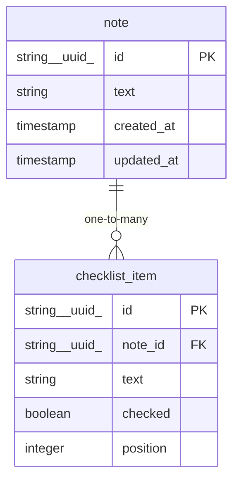

# Data Model

<!-- sdlc:auto:start entities -->
### note

| Field | Type | PK | FK | Nullable |
|---|---|---|---|---|
| id | string (uuid) | True | — | False |
| text | string | False | — | False |
| created_at | timestamp | False | — | False |
| updated_at | timestamp | False | — | False |

### checklist_item

| Field | Type | PK | FK | Nullable |
|---|---|---|---|---|
| id | string (uuid) | True | — | False |
| note_id | string (uuid) | False | note.id | False |
| text | string | False | — | False |
| checked | boolean | False | — | False |
| position | integer | False | — | False |
<!-- sdlc:auto:end entities -->

<!-- sdlc:auto:start relationships -->
| Source | Target | Type |
|---|---|---|
| note | checklist_item | one-to-many |
<!-- sdlc:auto:end relationships -->

<!-- sdlc:auto:start er-diagram -->

<!-- sdlc:auto:end er-diagram -->
