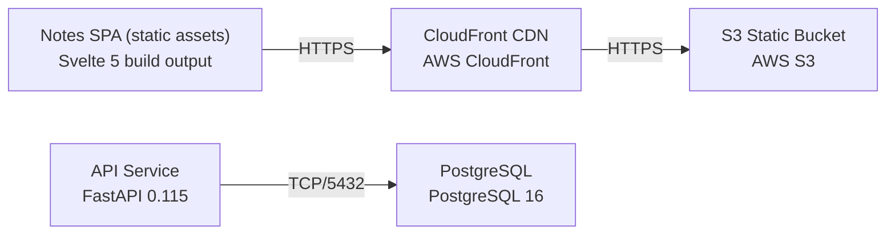

# Deployment Guide

> Maintained by QuorQ AI SDLC. Text between `sdlc:auto` markers is regenerated; anything outside them is yours and is kept.

<!-- sdlc:auto:start how-it-deploys -->
Pushes to `main` run `.github/workflows/deploy.yml`, which builds the API image (if there is a backend) and deploys the SPA to AWS Amplify. Commits touching only `docs/sdlc/**` don't deploy. Deployments can also be started from the platform's Deployment tab.
<!-- sdlc:auto:end how-it-deploys -->

<!-- sdlc:auto:start environments -->
| Name | Service | Runtime | Scaling | Environment |
|---|---|---|---|---|
| Notes SPA (static assets) | Svelte 5 build output | Browser | n/a (runs on the client) | dev |
| S3 Static Bucket | AWS S3 | AWS managed | n/a (object storage) | dev |
| CloudFront CDN | AWS CloudFront | AWS managed edge | global edge cache, India edge locations | dev |
| API Service | FastAPI 0.115 | Uvicorn (Python 3.12) | single small instance (health only, no note data) | dev |
| PostgreSQL | PostgreSQL 16 | AWS (managed or container) | single small instance, essentially empty | dev |
<!-- sdlc:auto:end environments -->

<!-- sdlc:auto:start live -->
_Not deployed yet._
<!-- sdlc:auto:end live -->

<!-- sdlc:auto:start topology -->

<!-- sdlc:auto:end topology -->
